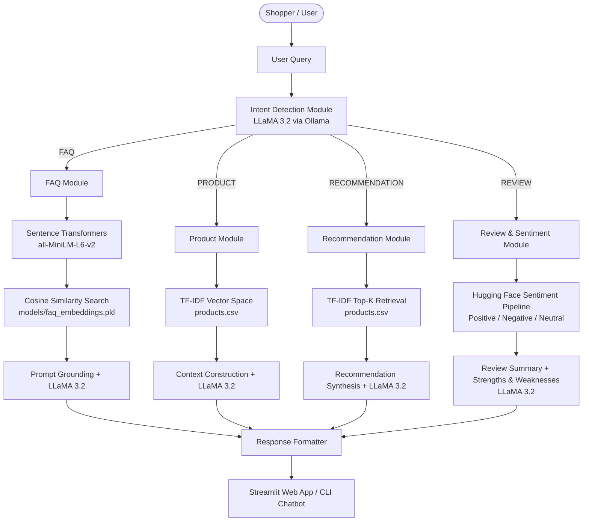

# 🛍️ ECommerceGPT — Intelligent E-Commerce AI Assistant

[](https://www.python.org/)
[](https://streamlit.io/)
[](https://ollama.ai/)
[](https://huggingface.co/)
[](LICENSE)

An intelligent, full-featured AI assistant tailored for e-commerce platforms. **ECommerceGPT** combines Retrieval-Augmented Generation (RAG), local Large Language Models (LLaMA 3.2 via Ollama), semantic vector search, and transformer-based sentiment analysis to deliver conversational customer support, smart product discovery, and deep review insights.

---

## 📌 Table of Contents

- [Overview](#-overview)
- [Key Features](#-key-features)
- [System Architecture](#-system-architecture)
- [Repository Structure](#-repository-structure)
- [Dataset Details](#-dataset-details)
- [Prerequisites](#-prerequisites)
- [Installation & Setup](#-installation--setup)
- [Running the Application](#-running-the-application)
  - [1. Streamlit Web UI](#1-streamlit-web-ui)
  - [2. Terminal CLI Chatbot](#2-terminal-cli-chatbot)
  - [3. Standalone Modules](#3-standalone-modules)
- [How It Works](#-how-it-works)
- [Configuration & Customization](#-configuration--customization)
- [Troubleshooting](#-troubleshooting)
- [License](#-license)

---

## 🌟 Overview

Modern online shoppers expect instant, accurate answers about shipping policies, personalized product recommendations, and trustworthy summaries of hundreds of customer reviews. **ECommerceGPT** provides an end-to-end conversational AI solution operating locally on your hardware with no third-party API token costs or privacy leaks.

### Why ECommerceGPT?
- **Zero Cloud API Costs**: Powered by **Ollama** running **LLaMA 3.2** locally on your machine.
- **Accurate & Grounded (RAG)**: Prevents hallucinations by strictly grounding LLM responses in real product catalogs, customer reviews, and official store FAQs.
- **Multi-Modal AI Pipeline**: Integrates dense embeddings (`sentence-transformers`), sparse TF-IDF vectors (`scikit-learn`), sentiment classification (`transformers`), and generative AI.
- **Dual Interfaces**: Choose between a modern, responsive **Streamlit Web Dashboard** or a lightweight **CLI Chatbot**.

---

## 🚀 Key Features

| Feature | Description | Tech Stack |
| :--- | :--- | :--- |
| **🎯 Dynamic Intent Detection** | Classifies incoming user queries in real-time into `FAQ`, `RECOMMENDATION`, `PRODUCT`, or `REVIEW`. | LLaMA 3.2 via Ollama |
| **❓ Semantic FAQ Retrieval (RAG)** | Dense embedding similarity matching against store policies (orders, shipping, returns, refunds, COD) with confidence thresholding. | `all-MiniLM-L6-v2` + Cosine Similarity |
| **🔍 Product Search & Q&A** | Answers targeted questions about specifications, brand, price, category, and features strictly from product data. | TF-IDF Vectorizer + RAG Prompting |
| **💡 Smart Product Recommendations** | Discovers and ranks top matching products based on user preferences and generates tailored purchasing reasoning. | TF-IDF Retrieval + LLaMA 3.2 Synthesis |
| **📊 Customer Review & Sentiment Analysis** | Scans reviews, computes positive/neutral/negative sentiment scores with confidence, and synthesizes strengths, weaknesses, and buying suggestions. | Hugging Face Sentiment Pipeline + LLaMA 3.2 |
| **🖥️ Dual Interfaces** | Interactive Streamlit web interface with chat history and dataset metrics, plus a command-line REPL interface. | Streamlit & Python CLI |

---

## 🏗️ System Architecture



---

## 📂 Repository Structure

```
├── data/
│   ├── faqs.csv                 # E-commerce store FAQs (returns, shipping, payments, etc.)
│   ├── products.csv             # Product catalog (names, brands, categories, prices, ratings)
│   └── reviews.csv              # Customer reviews and individual ratings
├── models/
│   └── faq_embeddings.pkl       # Precomputed normalized sentence embeddings for faqs.csv
├── app.py                       # Streamlit web application with chat interface
├── chatbot.py                   # Terminal-based interactive chatbot
├── create_embeddings.py         # Utility script to generate & save models/faq_embeddings.pkl
├── faq_module.py                # FAQ retrieval and Ollama grounding
├── intent_module.py             # Intent classification engine (FAQ, REC, PRODUCT, REVIEW)
├── product_module.py            # Product details Q&A with TF-IDF and context constraints
├── recommendation_module.py     # Product recommendation with Top-K TF-IDF & LLM rationale
├── review_module.py             # Review sentiment analysis and structured summarization
├── requirements.txt             # Project Python dependencies
└── README.md                    # Project documentation
```

---

## 📊 Dataset Details

The repository includes curated datasets in the `data/` directory:

1. **`faqs.csv`**
   - Columns: `FAQID`, `Question`, `Answer`
   - Covers common e-commerce policies: order tracking, return timeframes, cancellations, delivery windows, cash on delivery (COD), warranties, address updates, refunds, payment options, and coupons.

2. **`products.csv`**
   - Columns: `ProductID`, `ProductName`, `Category`, `Brand`, `Price`, `Description`, `Rating`
   - Contains a diverse selection of products across brands (Lenovo, HP, Dell, etc.) with prices, ratings, and detailed descriptions.

3. **`reviews.csv`**
   - Columns: `ReviewID`, `ProductID`, `ProductName`, `Review`, `Rating`
   - 1,000+ realistic customer reviews reflecting genuine customer feedback across varying satisfaction levels.

---

## ⚙️ Prerequisites

1. **Python 3.9+** installed on your system.
2. **Ollama**:
   - Download and install Ollama from [ollama.com](https://ollama.com/).
   - Pull the default model:
     ```bash
     ollama pull llama3.2
     ```
   - Ensure the Ollama daemon is running locally on `http://localhost:11434`.

---

## 📦 Installation & Setup

### 1. Clone the Repository
```bash
git clone https://github.com/rhemiSINGH26/gpt_exp1.git
cd gpt_exp1
```

### 2. Create and Activate a Virtual Environment
- **On Windows (PowerShell):**
  ```powershell
  python -m venv venv
  .\venv\Scripts\Activate.ps1
  ```
- **On Linux / macOS:**
  ```bash
  python3 -m venv venv
  source venv/bin/activate
  ```

### 3. Install Dependencies
```bash
pip install --upgrade pip
pip install -r requirements.txt
```

### 4. Verify or Rebuild FAQ Embeddings (Optional)
The precomputed embeddings file `models/faq_embeddings.pkl` is already included. If you edit `data/faqs.csv`, re-generate it:
```bash
python create_embeddings.py
```

---

## 🎮 Running the Application

### 1. Streamlit Web UI

Launch the rich web user interface:

```bash
streamlit run app.py
```

- Open your browser at `http://localhost:8501`.
- Explore dataset statistics in the sidebar (Products, FAQs, Reviews).
- Chat naturally about products, ask policy questions, request recommendations, or check reviews.

### 2. Terminal CLI Chatbot

For quick testing or command-line interaction:

```bash
python chatbot.py
```

- Type your question when prompted (`You: ...`).
- Type `exit` to terminate the session.

### 3. Standalone Modules

Each module can also be tested independently:

- **Intent Classifier**:
  ```bash
  python intent_module.py
  ```
- **FAQ Matching**:
  ```bash
  python faq_module.py
  ```
- **Product Q&A**:
  ```bash
  python product_module.py
  ```
- **Product Recommendation**:
  ```bash
  python recommendation_module.py
  ```
- **Review Analysis**:
  ```bash
  python review_module.py
  ```

---

## 🔍 How It Works

### 1. Intent Detection (`intent_module.py`)
Incoming queries are classified into one of four distinct categories:
- **`FAQ`**: Questions about order tracking, delivery timelines, return policies, payment methods, or customer support.
- **`RECOMMENDATION`**: Shoppers looking for suggestions (e.g., *"Suggest a good laptop for programming under ₹60,000"*).
- **`PRODUCT`**: Questions inquiring about specific product details, specs, or pricing.
- **`REVIEW`**: Questions about user ratings, opinions, and feedback for a given product.

### 2. Semantic FAQ Retrieval (`faq_module.py`)
Uses `sentence-transformers/all-MiniLM-L6-v2` to map the user question into vector space and computes cosine similarity against pre-embedded FAQ questions. If similarity exceeds the `0.55` threshold, Ollama formulates a polite, natural response grounded strictly in the retrieved answer.

### 3. Product Search & Recommendations (`product_module.py` & `recommendation_module.py`)
Combines product name, category, brand, and description into a single searchable text corpus. TF-IDF vectorization finds exact and contextual matches. For recommendations, top-3 candidates are passed into LLaMA 3.2 to select the best fit with explicit reasoning.

### 4. Review & Sentiment Analysis (`review_module.py`)
Extracts all reviews for the target product, passes each review through a Hugging Face sentiment analysis pipeline (`POSITIVE` / `NEGATIVE` / `NEUTRAL`), tallies sentiment statistics, and prompts LLaMA 3.2 to generate a structured report:
- **Overall Opinion**
- **Strengths**
- **Weaknesses**
- **Buying Suggestion**

---

## 🛠️ Configuration & Customization

- **Change Ollama Model**: By default, `llama3.2` is used. You can switch to any other model installed in Ollama (e.g., `mistral`, `llama3:8b`, `phi3`) by updating the `model` parameter in:
  - `intent_module.py`
  - `faq_module.py`
  - `product_module.py`
  - `recommendation_module.py`
  - `review_module.py`
- **Similarity Threshold**: In `faq_module.py`, tweak `threshold = 0.55` to make FAQ matching stricter or more lenient.
- **Add More Products/Reviews**: Simply append rows to `data/products.csv`, `data/reviews.csv`, or `data/faqs.csv`.

---

## ❓ Troubleshooting

| Issue | Cause | Solution |
| :--- | :--- | :--- |
| `Cannot connect to Ollama` | Ollama daemon is not running. | Run `ollama serve` in a separate terminal. |
| `Model llama3.2 not found` | The model has not been downloaded yet. | Run `ollama pull llama3.2`. |
| `FileNotFoundError: models/faq_embeddings.pkl` | Embeddings pickle file is missing. | Run `python create_embeddings.py` to regenerate it. |
| `CUDA out of memory` | GPU VRAM is full while running transformer pipelines. | Use CPU mode or close other GPU-intensive tasks. |

---

## 📄 License

This project is licensed under the [MIT License](LICENSE).
